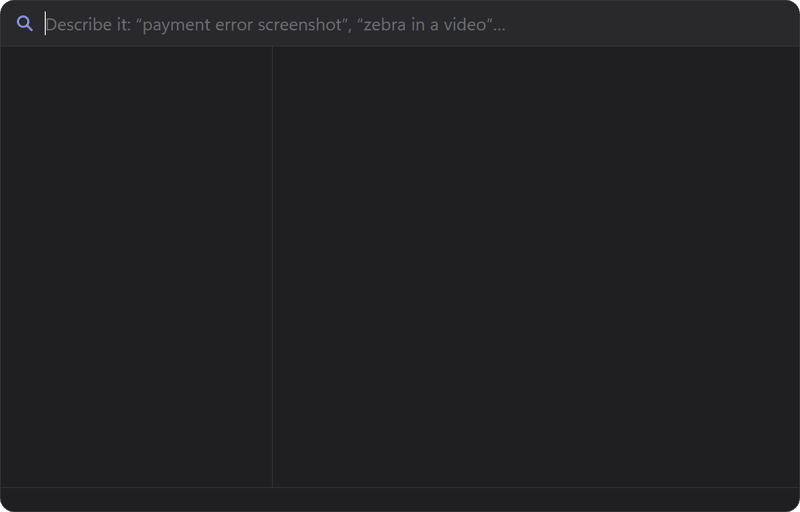

<p align="center">
  
</p>

<h1 align="center">Trovara</h1>

<p align="center">
  <b>Describe it. Find it.</b><br>
  Private search for everything on your Windows PC, by what's <i>in</i> it.
</p>

<p align="center">
  <a href="LICENSE"></a>
  
  
  
</p>

<p align="center">
  
</p>

Press **Ctrl+Shift+Space** from any app and describe what you're looking for, the way you remember it, in any
language. Trovara finds pictures, screenshots, PDFs, documents, recordings, videos and code, and opens the match at
the right place: the PDF at the page, the video at the moment, the code at the line.

It runs Google DeepMind's EmbeddingGemma 2 on your own PC (on your GPU when there is one). Nothing you index ever
leaves it.

## What it finds

| You type | Trovara finds |
|---|---|
| `red car` | The photo of a red car, even if it's named `DSC_1001.png` |
| `payment declined` | The screenshot with those words on screen (read with Windows' own OCR) |
| `security deposit` | The page of the lease that says so, the words marked yellow |
| `the scene at the lake` | The moment in a video, and it plays from there |
| `what the teacher said about exams` | The minute of a recording where it's said |
| `code: refresh the access token` | The function that does it, opened at its line in your editor |

## Features

- **Search by meaning and by words at once.** Results appear as you type, and meaning results follow when you pause.
  A file's name counts too: `pan card` finds `PAN_Card_Front_View.jpeg`.
- **Every kind of file.** JPEG, PNG, HEIC, WebP and RAW photos. Screenshots and scanned PDFs are read with OCR. PDF,
  Word, Excel, PowerPoint, OpenDocument, RTF, EPUB, Markdown, emails (`.eml`, `.msg`), CSV. MP3, WAV, M4A. MP4,
  MKV and AVI, including their subtitles.
- **Previews that show why it matched.** The found words are marked yellow, on the PDF page itself, in screenshots,
  in documents and in code. Markdown is shown formatted and code is coloured.
- **A large viewer.** Press **Space**, or click the preview, to see the file large. Zoom with Ctrl + mouse wheel and
  turn PDF pages with ← / →.
- **Code search.** Add your repos, then search with `code:` by what the code does or by a name in it. It opens in
  VS Code, Cursor, Visual Studio, JetBrains IDEs, Sublime Text, Notepad++, Zed and others.
- **Stays up to date by itself.** New and changed files are read as they arrive. Indexing waits while you game or
  watch something fullscreen, and goes easy on battery.
- **Private by design.** No account and no cloud. The index lives in `%LOCALAPPDATA%\Trovara`.

## Install

1. Download `Trovara_<version>_x64-setup.exe` from [Releases](https://github.com/Subhankar-Patra1/trovara/releases).
2. Run it. It installs for you only, so no administrator rights are needed. On the last page, keep
   **Create desktop shortcut** ticked if you want an icon on the desktop.
3. Setup asks which folders to search, then downloads the model once (865 MB) and starts reading your files in the
   background. You can search right away: files are found by name until they've been read.

Windows 10 (22H2) or Windows 11, 64-bit, with 8 GB of RAM (16 GB recommended) and about 2 GB of free disk space.
A GPU with Vulkan makes indexing about 10× faster, but none is needed.

## Keys

| Key | Does |
|---|---|
| **Ctrl+Shift+Space** | Open the search panel (you can change it in Settings) |
| **↑ / ↓** | Move between results |
| **Space** | View the result large |
| **Enter** | Open it, at the page or moment |
| **Ctrl+Enter** | Show it in Explorer |
| **Ctrl+C** | Copy the file, to paste into a chat, a mail or a folder |
| **Ctrl+O** | Open the larger search window, with filters by kind |
| **Tab** | Search the same words in your code |
| **Esc** | Close |

## Privacy

Trovara goes online for three things only: to download the model once, to check for updates (you can turn this off),
and to fetch optional add-ons you ask for. Your files, your searches and the index never leave your PC.

## Build from source

You need Rust (stable, MSVC toolchain), Visual Studio 2022 or 2026 with "Desktop development with C++", Git, and
optionally the [Vulkan SDK](https://vulkan.lunarg.com/sdk/home#windows) for GPU support.

```powershell
scripts\build-llama.ps1     # llama.cpp at the pinned tag → vendor\llama (a few minutes)
scripts\fetch-vendor.ps1    # PDFium → vendor\pdfium
cargo build --release --workspace
target\release\trovara.exe
```

`vendor\` and `third_party\llama.cpp\` aren't in the repository: the two scripts above fetch and build them. Add
`-Cuda` to `build-llama.ps1` for the optional CUDA pack (needs the CUDA toolkit).

To build the installer you also need Node.js, for the Tauri CLI:

```powershell
scripts\release.ps1         # → target\release\bundle\nsis\Trovara_<version>_x64-setup.exe (~16 MB)
```

<details>
<summary>The command-line helper</summary>

```powershell
trovara-helper download-model
trovara-helper index $HOME\Pictures $HOME\Documents
trovara-helper search "a dog on the beach"
trovara-helper status
```

</details>

<details>
<summary>Project layout</summary>

| Path | What |
|---|---|
| `crates/trovara-core` | The engine: index, ranking, rules, code search |
| `crates/trovara-win` | Windows layer: WIC, OCR, Media Foundation, power, file IDs |
| `crates/trovara-extract` | Readers: PDF, Office, EPUB, email, subtitles, code |
| `crates/trovara-llama` | EmbeddingGemma 2 on llama.cpp |
| `crates/trovara-helper` | The background worker and the CLI |
| `crates/trovara-usn` | A small reader of the NTFS change journal (optional fast catch-up after a restart) |
| `app/` | The app (Tauri 2): tray, hotkey panel, search window, setup, settings |
| `scripts/` | Build and release scripts |
| `evals/` | Ranking evals |

</details>

## License

[MIT](LICENSE) © 2026 Subhankar Patra.

Trovara ships third-party components under their own licenses: see [THIRD_PARTY_NOTICES.md](THIRD_PARTY_NOTICES.md),
and Settings → About → Licenses in the app. The EmbeddingGemma 2 model isn't part of Trovara. It's downloaded on first
launch under Google's [Gemma Terms of Use](https://ai.google.dev/gemma/terms).
